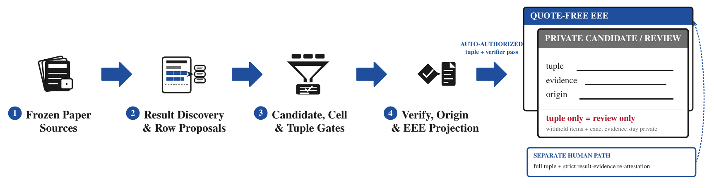

# Proceedings to Every Eval Ever

ERE extracts evaluation results from scientific papers and turns them into
[Every Eval Ever (EEE)](https://github.com/evaleval/every_eval_ever) records that preserve
the context needed to interpret each reported score. It connects values to the evaluated
system, dataset, metric and experimental setting, together with a precise reference to
where the result appears in the paper.

The basic unit is a candidate observation representing one reported result and the
evidence supporting its proposed interpretation. Several observations can be grouped
into an EEE record for the same evaluated system within a paper, while retaining their
individual values and source references.



The pipeline freezes source documents and recovers their page layout before language
models propose candidates from sections containing reported results. Each candidate
preserves the printed names and values alongside its page and table, figure or prose
location, allowing later checks to return to the same evidence. Models help propose and
review interpretations, while code applies the export rules, composes eligible records
and validates the resulting JSON against the pinned EEE schema.

Result interpretation and producer origin are treated separately because a paper can
report a baseline score that originally came from another publication. Human review
provides a separate way to assess candidates and record decisions against the frozen
source material, keeping those decisions distinct from model judgments.

The figure illustrates the stricter workflow. For a run over a whole paper collection
the pipeline also supports export through a separate review of individual evidence
pages. The default `positive_only` policy requires positive evidence that the paper
produced the result, whereas `tiered` permits weaker evidence bases with their review
status and unresolved checks recorded in the output.

The pipeline has been run on real papers twice: over 105 papers of a toxicity paper
collection in September 2026, and with the current code over ten of those papers in
October 2026. The [results page](docs/results.md) describes both runs and what changed
between them, and the [results folder](results/README.md) holds the per-value tables,
the EEE records and the comparison.

The [project guide](docs/project-guide.md) is the best starting point for understanding
these concepts and how the different workflows fit together, and the
[architecture documentation](docs/architecture.md) describes the stages, their
interfaces and the evidence and export requirements the implementation follows.

To run the synthetic example, install Python **3.12**, `uv` and Poppler (`pdftotext` and
`pdfinfo`), then execute the following commands from the repository.

```bash
uv sync --frozen --group dev
uv run --frozen ere demo --output runs/demo
uv run --frozen ere verify-run runs/demo/derived
```

The demo creates a synthetic paper and follows it through extraction, a fixed example
review and EEE export without calling a model provider. The
[example files](examples/quickstart/README.md) provide sample inputs and outputs, and
the offline test suite can be run with `uv run --frozen pytest -q`.

For real papers, the [corpus template](examples/quickstart/corpus-template.yaml) defines
the inputs, and `uv run --frozen ere run-corpus --help` lists the model and budget
options. These runs use `OPENROUTER_API_KEY`, while source PDFs, provider responses and
private annotations remain local and separate from the code and synthetic examples
included in this repository.
